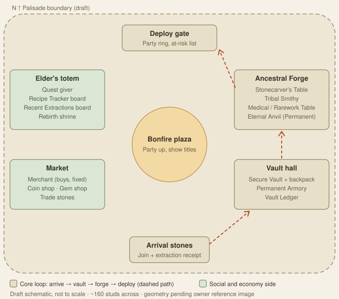

# Lobby hub — map design

> **Status:** Draft 0.2 (2026-10-23). The station list and flow follow confirmed GDD rules, including owner answers Q166–Q169 (GDD §46). **The geometry is provisional** until the owner supplies a reference image.
> **GDD sources:** §2.1, §9.1–9.2, §10, §16.1–16.2, §16.8, §25.1–25.2, §25.4.1, §31, §33, §36.3–36.5, §45, §46, Q24, Q80, Q98, Q105, Q155, Q161c, Q163, Q164

The GDD is the source of truth. If this document disagrees with it, the GDD wins and this document must be corrected.

## Purpose

The lobby is the **secure hub** between runs, and its own place in the universe (Q163). Players arrive here after an extraction or a death, settle their loot, craft and trade safely, party up and deploy into a public world. Nothing in the lobby is ever at risk (`LobbySafe`, §31.2).

**Current build:** the shipped lobby (v0.03–v0.18) is menu-driven: every station is a panel opened from the hub menu or a hotkey (for example G for the vault, F for the Forge). This document designs the **physical hub** those panels live in. Because a menu can open every station from anywhere (Q167), the physical stations are landmarks and walk-up shortcuts, never gates.

The hub is **small on purpose**. It is a place to pass through, not to explore.

## Required contents

Every row below is required by a confirmed rule. The station is this draft's proposal.

| Need | Rule | Station in this draft |
| --- | --- | --- |
| Arrival point after extraction, death and first join | Extraction and death send players to the separate lobby (Q24, §5.3) | **Arrival stones** |
| Post-extraction receipt | Base and 2× quantities, XP, deleted overflow, pending state (§25.2) | Receipt panel shown at the Arrival stones |
| Deploy with a full at-risk item list | Play deploys every unvaulted item except materials (Q155, Q164) | **Deploy gate** |
| Party queue into one world | Tribe regroups in the lobby after a death (Q161c) | Party ring at the Deploy gate; party-up in the plaza |
| Secure vault and durable lobby backpack | Every extracted material banks into the vault; gear waits in the lobby backpack (Q164, Q164a, Q152) | **Vault hall**: Secure Vault |
| Permanent Armory | Hub navigation (§25.1) | Vault hall |
| Vault capacity upgrades (+25 slots, Gems or Robux) | §10.3, §25.4.1 | Vault hall: Vault Ledger |
| Special Forge and secure workbenches (default quality) | §16.2, Q105 | **Ancestral Forge**: Stonecarver's Table, Tribal Smithy, Medical / Rarework Table, Eternal Anvil |
| Recipe Tracker and Recent Extractions | Hub navigation (§25.1) | **Elder's totem**: two boards |
| Coin quests (250 / 1,000 / 3,000) and guided quests | §10.1, §36.5 | Elder's totem: quest giver |
| NPC merchant with fixed buy quotes | §10.1, Q95 | **Market**: Merchant |
| Coin shop and Gem or Robux offers | §10.1, §36.2 | Market: Coin shop, Gem shop |
| Lobby-only direct trading (items and Gems, never Coins) | Q98, §10.2, Q168 | Market: trade stones (a meeting point; trades start anywhere) |
| Rebirth, token perks and respec | §36.3 | Elder's totem: Rebirth shrine |
| Mastery titles and levels visible to others | Q80 | Overhead titles everywhere; the plaza is the place to be seen |

Station names come from the GDD's **Proposed** list (§16.2) and are not final.

## Draft layout

A walled camp around a central **bonfire plaza**. North is the Deploy gate; south is the Arrival stones.

- **East side: progression path.** Arrival stones → **Vault hall** → **Ancestral Forge** → **Deploy gate**. A player back from a run walks past the receipt, the vault and the Forge, and reaches the gate with the at-risk list in front of them. This makes "vault your gear before you deploy" the natural route (Q155).
- **West side: social and economy.** The **Market** (merchant, shops, trade stones) and the **Elder's totem** (quests, boards, rebirth). Players who are only trading or shopping stay out of the deploy traffic.
- **Centre: bonfire plaza.** Party up, show titles and gear, wait for the tribe. Weapons can be swung here harmlessly (Q169).

### Zones

| Zone | Contents | Notes |
| --- | --- | --- |
| Arrival stones | Arrival points for first join, extraction and death return | The receipt opens on arrival. Several spawn points, so a returning tribe doesn't stack on one spot |
| Bonfire plaza | Open space, seating, party prompts | Kept clear of station prompts so idle players don't block interactions |
| Vault hall | Secure Vault (materials + items), lobby backpack view, Permanent Armory, Vault Ledger | First station on the return path. Ledger handles capacity upgrades and history |
| Ancestral Forge | Four stations from §16.2 | Lobby crafting is default quality (Q105). The Eternal Anvil is the visual centrepiece (Permanent conversion) |
| Deploy gate | Party ring, Deploy prompt, at-risk list, matchmaking status | The gate faces out of the camp. In the art pass the crater can be visible on the horizon behind it |
| Market | Merchant (buys at fixed quotes), Coin shop, Gem shop, trade stones | Rare-material sales show a strong warning (§25.4.1). Coins can never be added to a trade |
| Elder's totem | Quest giver, Recipe Tracker board, Recent Extractions board, Rebirth shrine | A natural first stop for guided quests |

## Size and movement targets — Proposed

| Value | Placeholder | Reason |
| --- | --- | --- |
| Players per lobby server | **20 (confirmed Q166)** | Sizes the plaza and the arrival points |
| Playable footprint | ~160 × 160 studs | Roomy for 20; at Roblox's default 16 studs/s it is ~10 s wall to wall. May shrink to match the reference image |
| Plaza to any station | ≤ ~80 studs (~5 s walk) | Stations never feel like a trek |
| Arrival → Vault → Forge → Deploy path | ≤ ~250 studs (~15 s) | A full return-and-redeploy loop costs seconds |
| Station interaction | Proximity prompt, touch- and controller-friendly; every station is also in the hub menu (Q167) | §11 |
| Sprint | Allowed; no stamina cost in the lobby | Nothing is at stake here |

## Safety rules for the map

- The lobby is **not active gameplay**. No downed state, no corpses, no building and no resource nodes (§31.2).
- **Weapons can be swung and fired, but nothing takes damage and every player is invulnerable** (Q169).
- The world's tags (`SpawnCandidate`, `SafeZone`, extraction sites, resource nodes …) must never appear in the lobby place, so no world service can treat a lobby player as in a run.
- Kill planes and invisible walls keep players inside the palisade. There is no out-of-bounds area to hide in or clip through.

## Authoring and tags

Lobby geometry is authored in Studio and published from Studio to the lobby place, because the release pipeline only ships scripts (`docs/roblox-live-deployment.md`). Map models synced through Rojo go under `src/maps/Lobby/` (`ServerStorage.Maps`). Gameplay finds the stations through CollectionService tags, the same way world services find theirs:

| Tag | On |
| --- | --- |
| `LobbyArrival` | Each arrival spawn point |
| `DeployGate` | The gate's prompt part |
| `PartyArea` | The party ring volume |
| `LobbyStation:<id>` | Each station's prompt part. Ids: `Vault`, `Armory`, `VaultLedger`, `Stonecarver`, `TribalSmithy`, `RareworkTable`, `EternalAnvil`, `Merchant`, `CoinShop`, `GemShop`, `TradeStone`, `QuestGiver`, `RecipeBoard`, `ExtractionBoard`, `RebirthShrine` |

A walk-up prompt opens the same panel as the hub menu; it adds no new server path.

**Automated checks (when the map exists):** every `LobbyStation` id above is tagged exactly once (`TradeStone` may repeat), at least one `LobbyArrival` and one `DeployGate` exist, and no world-only tag is present.

## Owner answers (GDD §46)

| # | Confirmed decision | Map consequence |
| --- | --- | --- |
| **Q166** | A lobby server holds **20 players**. | The plaza and stations only need to fit 20 |
| **Q167** | A **hub menu opens any station from anywhere** in the lobby. | Stations are landmarks and shortcuts. The layout optimises for feel and readability, not for forcing a route |
| **Q168** | **Trades can be started anywhere** in the lobby. | The trade stones are a social meeting point, not a requirement |
| **Q169** | **Weapons can be used but deal no damage; every player is invulnerable.** | Leave room in the plaza for players to show off gear |

## Open questions for the owner

| # | Question | Proposed default |
| --- | --- | --- |
| **Q170** | Setting and look of the hub (cliff-top village, beach camp, ruin…)? | Answered by the owner's reference image |
| **Q171** | Is the Deploy gate a walk-in party ring or just a prompt that opens the Deploy screen? | Walk-in ring: the party stands in it, then the leader confirms on the Deploy screen |

## Next steps

1. Owner supplies the reference image. Redraw the plan to match it and resolve Q170.
2. Greybox the hub in Studio with the tags above, publish it to the lobby place, then walk the timings on desktop and mobile.
