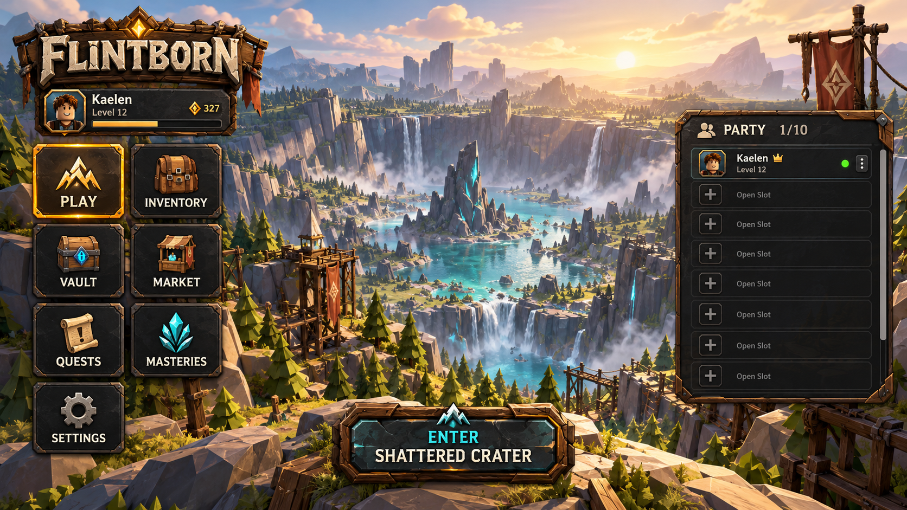
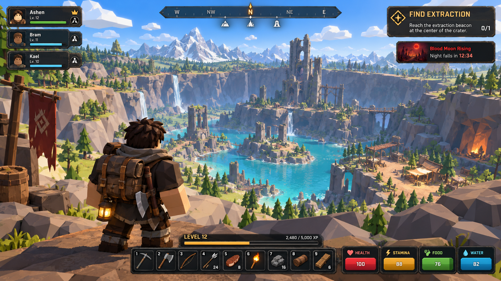

# Flintborn UI Style Guide

This guide records the current direction for Flintborn's lobby and in-game HUD. It complements the world art direction in [visuals.md](visuals.md) and the implemented UI tokens in [Theme.luau](src/client/Ui/Theme.luau).

## Design intent

Flintborn's interface should feel like field equipment made for a bright, dangerous world: sturdy, hand-crafted, easy to scan, and visually connected to the chunky low-poly environments. Panels frame the game without hiding it. Use clear hierarchy and short labels so players can read the HUD during movement and combat.

Treat the UI as a system across lobby, menus, and gameplay rather than a set of unrelated screens.

## Visual language

- **Materials:** Use carved timber, worn leather, dark slate, and restrained metal details as framing materials. Keep texture and bevel details around panel edges; keep content areas calm.
- **Panel surfaces:** Prefer dark charcoal-brown or slate surfaces with enough translucency to keep the world visible beneath large panels. Preserve strong text contrast. Use opaque surfaces for small controls when transparency would hurt legibility.
- **Color:** Follow `Theme.luau` tokens rather than introducing one-off values. Current anchors are Panel (RGB 24, 20, 17), Card (38, 32, 27), Button (110, 70, 30), Text (235, 226, 212), Heading (255, 214, 150), Good (160, 230, 160), and Warn (255, 170, 120). Amber signals selection, action, and progression; cyan is a secondary highlight. Health and survival states may use their established semantic colors.
- **Shape:** Use square silhouettes for navigation buttons, item slots, and repeated icon controls. A subtle bevel or clipped corner can carry the crafted look, while the usable hit area remains a true square. Larger panels may be rectangular.
- **Typography:** Keep labels short, bold, and high contrast. Use a clear size hierarchy: compact supporting text, readable control labels, and larger screen titles. Avoid decorative type for small or frequently read values.
- **Detail:** Reserve ornament for panel frames, selected states, and important rewards. Avoid noisy texture behind text, thin internal dividers, and excess glow.

## Lobby

- Keep navigation on the left as a two-column grid of square icon buttons. The selected destination uses a clear amber state; inactive controls stay quieter.
- Show the party as a roster with a visible count such as **PARTY 1/10**. The roster supports up to ten players and scrolls when entries exceed the visible area.
- Make the destination action compact and distinct from the navigation. Use a two-line label such as **ENTER / SHATTERED CRATER**.
- Keep player identity, currency, and party-management controls secondary to the world and the destination action.
- Lobby imagery should remain visible through spacious layout and restrained panel opacity.

## In-game HUD

- Keep the center of the screen clear for movement, combat, and world reading.
- Present **Find Extraction** as a quest tracker: a short quest title, one actionable objective, and a compact completion count or progress indicator. The tracker should be readable at a glance and collapsible or compact when needed.
- Place a compact party/player stack at the upper left and a compass near the top center. Keep event alerts secondary to the active quest.
- Use four compact survival meters for health, stamina, food, and water. Each meter is a smooth, solid fill with no internal tick marks, segment lines, or gridlines. Put the value inside the bar and keep its label/icon immediately identifiable.
- Keep the hotbar centered near the bottom. Every hotbar slot and item cell is square. The survival-meter cluster should share the hotbar's bottom alignment.
- Put a small level and XP widget immediately above the hotbar. Show the level, a single thin progress strip, and current/required XP without competing with the active quest or survival meters.
- Scale and reposition HUD groups for narrow screens without changing their reading order. Maintain the 44 px minimum touch target and the existing `UiScale`, `ColourBlind`, `ReducedMotion`, and `Subtitles` accessibility settings in `Theme.luau`.

## Reference images

These images are visual direction, not production UI exports. Text, player names, counts, and values are illustrative. Use the existing game design documents and code as the source of truth for game behavior and exact values.

### Lobby concept

### Gameplay HUD concept

